# Katalog Toko Alat Tulis — Express + Prisma + Neon PostgreSQL

**Laporan Evidence Tugas Express API: Prisma & Neon PostgreSQL**

| | |
| --- | --- |
| Nama | Muhamad Sabilil Haq |
| NRP | 5027251041 |
| Mata kuliah | Pemrograman Web |

Proyek ini melanjutkan tugas sebelumnya (CRUD Express dengan data di array/memori).
Sekarang data produk disimpan di **PostgreSQL (Neon)** dan diakses melalui **Prisma ORM**,
sehingga data tetap ada walaupun server dijalankan ulang.

---

## Evidence skenario & perubahan database

Setiap skenario menampilkan aksi di aplikasi serta kondisi tabel `products` di Neon
**sebelum** dan **sesudah** aksi dilakukan.

### 1. Migrasi: membuat tabel di Neon

Perintah `npx prisma migrate dev --name init` membaca `schema.prisma` lalu membuat tabel `products` di database Neon.

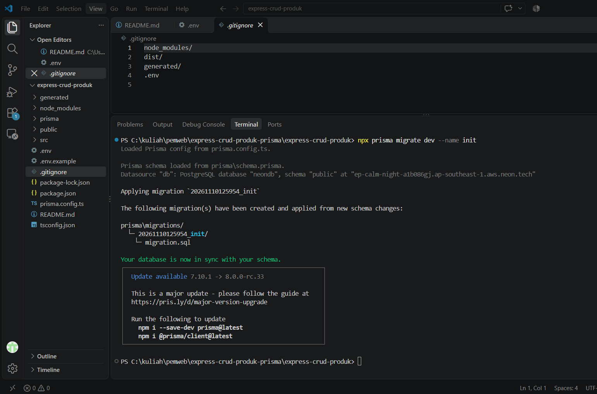

| Sebelum | Sesudah |
| --- | --- |
| 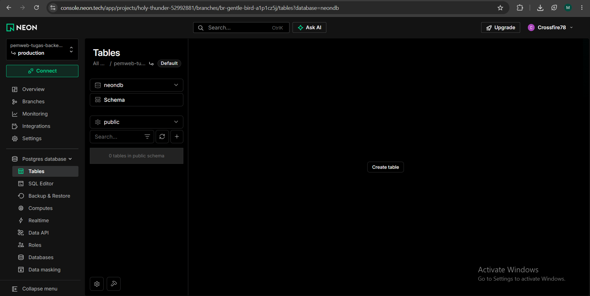 | 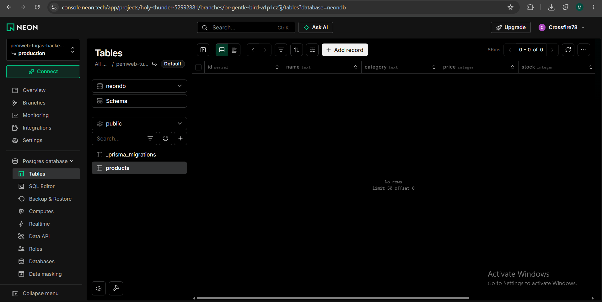 |

### 2. Seed: mengisi data awal

`npx prisma db seed` menjalankan `prisma/seed.ts` dan memasukkan 4 produk.

| Sebelum | Sesudah |
| --- | --- |
| Tabel kosong (lihat gambar sesudah migrasi di atas) | 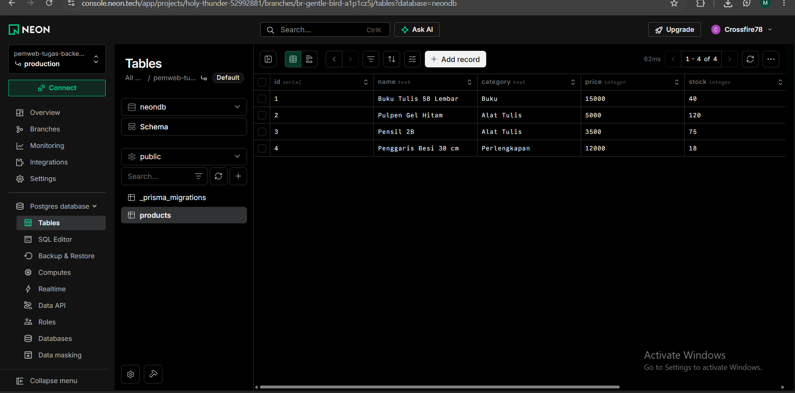 |

### 3. GET: menampilkan semua data

Ketika halaman dibuka, front-end mengirim `GET /api/products`. Controller menjalankan `prisma.product.findMany()`, dan data dari Neon tampil di tabel.

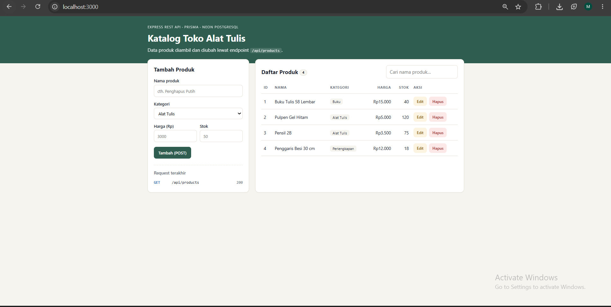

<!-- SS: terminal log "GET /api/products -> 200" -->
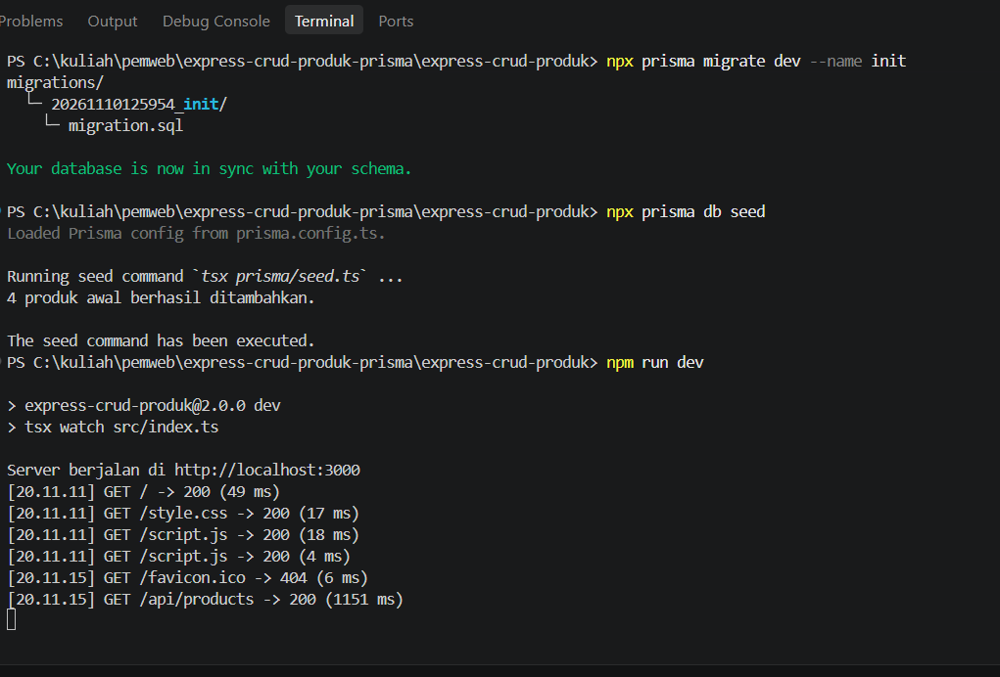

### 4. GET dengan pencarian (`?q=`)

Kolom pencarian mengirim `GET /api/products?q=pen`, lalu Prisma memfilter dengan `contains` (tidak membedakan huruf besar/kecil).

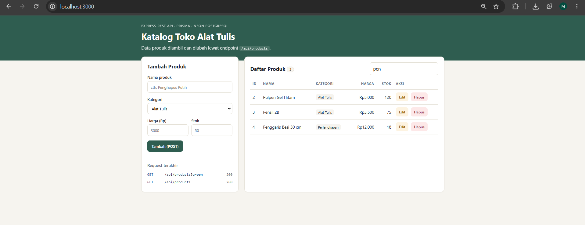

### 5. POST: menambah produk

Form diisi **Penghapus Putih**, kategori Alat Tulis, harga 3000, stok 60. Front-end mengirim `POST /api/products`, server menjalankan `prisma.product.create()` dan membalas **201 Created**.

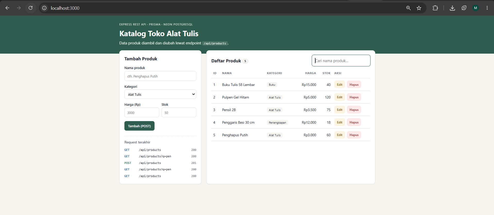

| Database sebelum | Database sesudah |
| --- | --- |
| 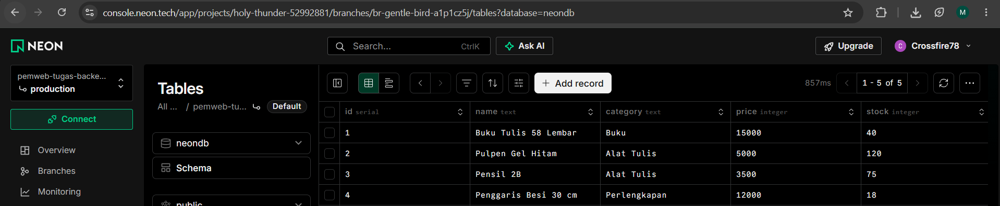 | 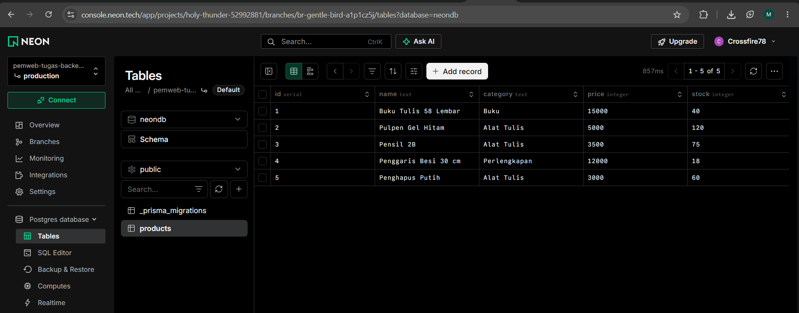 |

### 6. PUT: mengubah produk

Tombol **Edit** pada *Pulpen Gel Hitam* mengisi form lewat `GET /api/products/2`. Harga diubah dari 5000 menjadi 6000 dan stok dari 120 menjadi 100. Front-end mengirim `PUT /api/products/2`, lalu `prisma.product.update()` dijalankan.

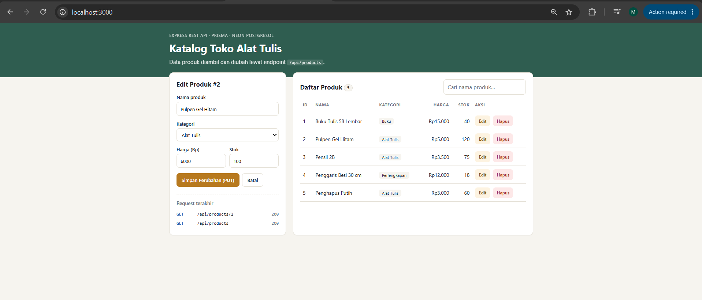

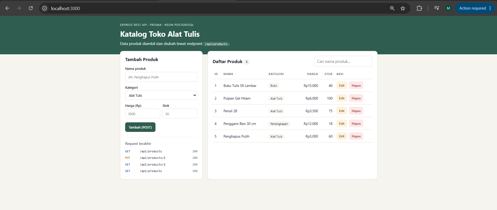

| Database sebelum | Database sesudah |
| --- | --- |
| 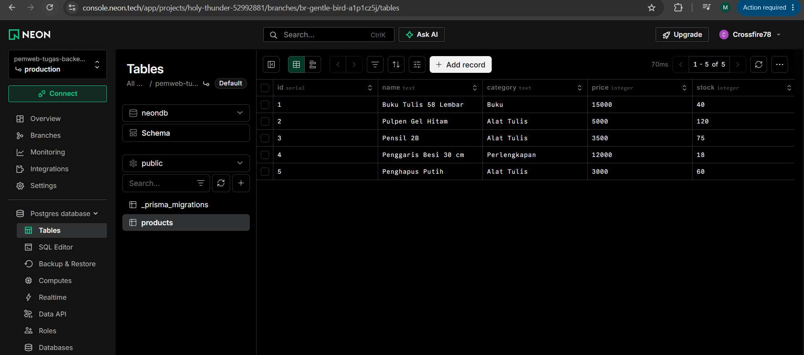 | 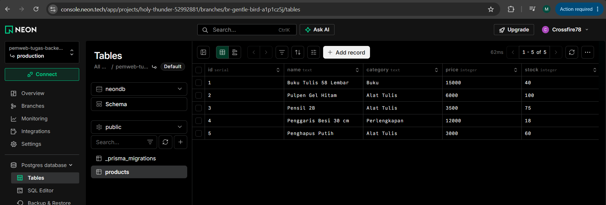 |

### 7. DELETE: menghapus produk

Tombol **Hapus** pada *Penggaris Besi 30 cm* (id 4) mengirim `DELETE /api/products/4`, lalu `prisma.product.delete()` dijalankan.

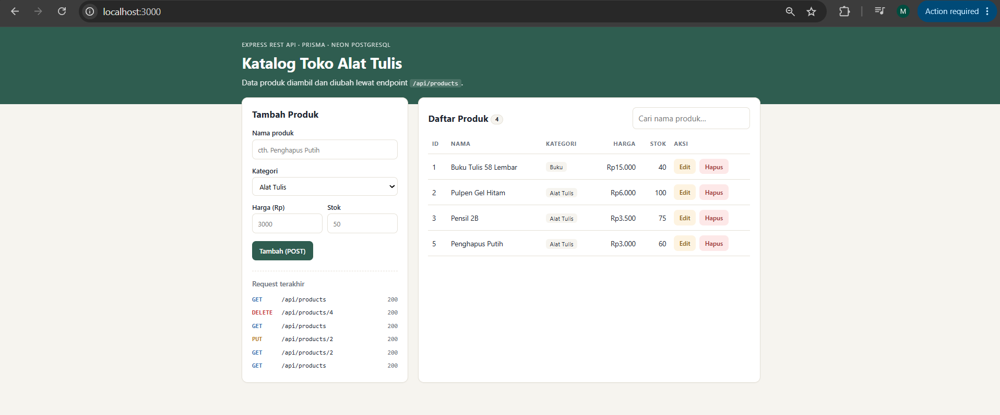

| Database sebelum | Database sesudah |
| --- | --- |
| 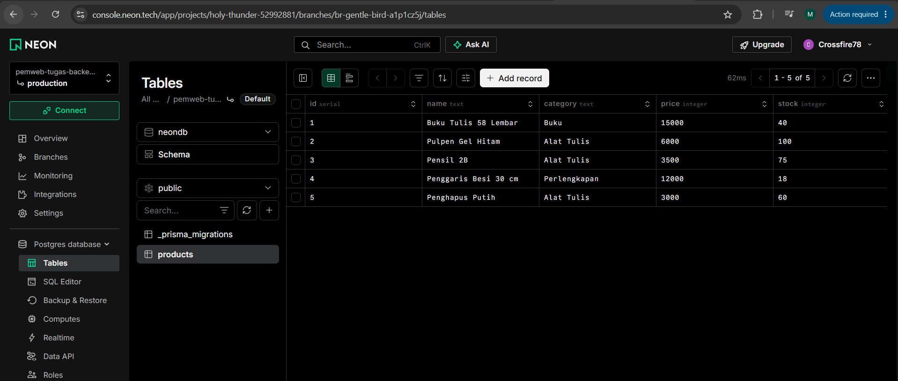 |  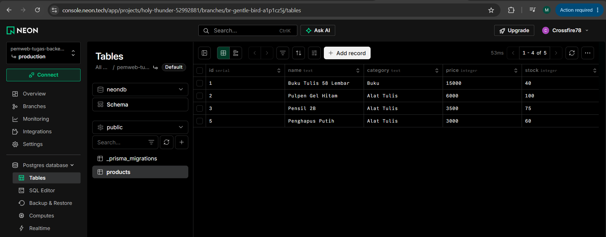 |

### 8. Data tetap ada setelah server di-restart

Server dihentikan (`Ctrl + C`) lalu dijalankan lagi dengan `npm run dev`. Setelah halaman di-refresh, data hasil POST, PUT, dan DELETE tetap ada. Ini membuktikan data tersimpan di database, bukan di memori seperti pada tugas sebelumnya.

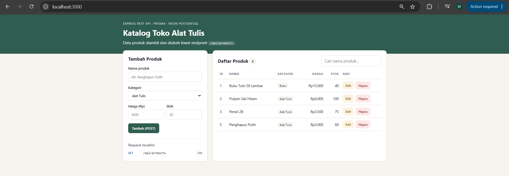

### 9. Skenario error

| Skenario | Request | Respons |
| --- | --- | --- |
| Body tidak valid | `POST /api/products` dengan `name` kosong | `400` `{"message":"name wajib diisi"}` |
| Produk tidak ada | `GET /api/products/999` | `404` `{"message":"Produk dengan id 999 tidak ditemukan"}` |
| Route tidak ada | `GET /alamat-lain` | `404` `{"message":"Route GET /alamat-lain tidak ditemukan"}` |

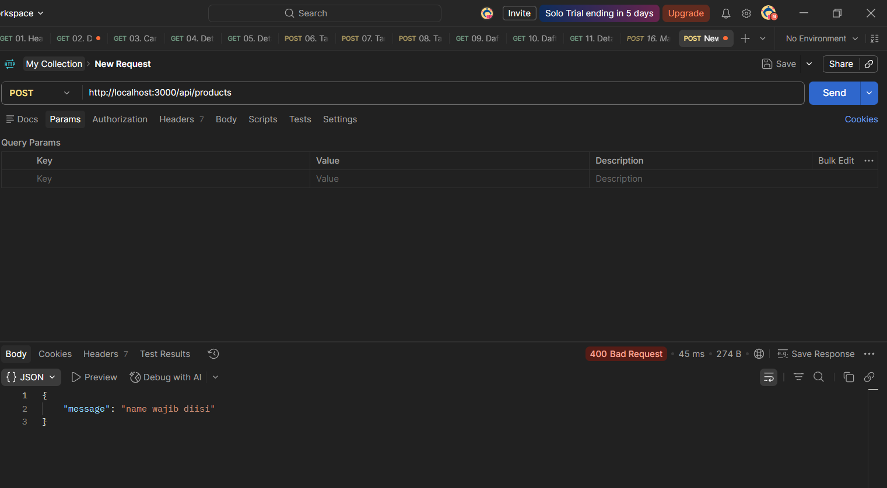

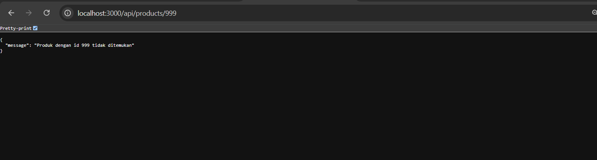
